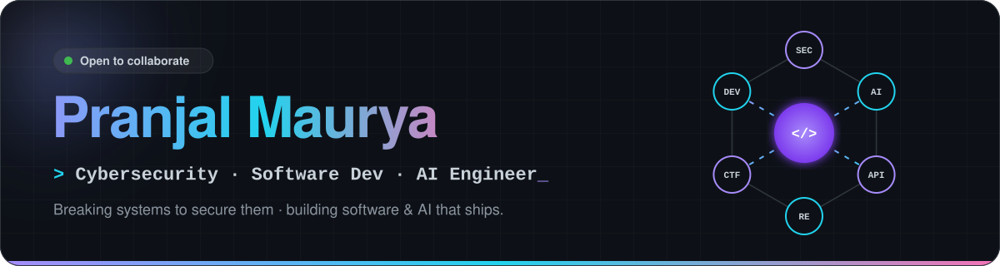

<!-- Generated by build.mjs from profile.config.json. Edit the config, not this file. -->
<div align="center">



<a href="https://github.com/pranjalmauryya"></a>

<p>
  
  <a href="https://github.com/pranjalmauryya?tab=followers"></a>
  <a href="https://github.com/pranjalmauryya?tab=repositories"></a>
</p>

</div>


<h2 align="center">About me</h2>

```ts
const pranjalmauryya = {
  role:              "Cybersecurity · Software Developer · AI Engineer",
  location:          "Lucknow, India",
  focus:             ["Offensive & defensive security", "Secure software development", "AI / LLM engineering", "Security automation"],
  currentlyBuilding: "AI-powered security tooling & autonomous agents",
  learning:          ["Reverse engineering", "Cloud security", "Multi-agent systems"],
  askMeAbout:        ["Pentesting", "Python & TypeScript", "LLM agents", "CTFs"],
  funFact:           "I read stack traces for fun, and exploits for breakfast",
};
```


<h2 align="center">Tech stack</h2>

<div align="center">

<p><sub><b>LANGUAGES</b></sub><br/></p>

<p><sub><b>SECURITY</b></sub><br/><br/>     </p>

<p><sub><b>AI &amp; DATA</b></sub><br/></p>

<p><sub><b>FRAMEWORKS</b></sub><br/></p>

<p><sub><b>CLOUD &amp; DEVOPS</b></sub><br/></p>

</div>


<h2 align="center">GitHub analytics</h2>

<div align="center">
  
  <br/><br/>
  
</div>

<div align="center">
  <picture>
    <source media="(prefers-color-scheme: dark)" srcset="https://raw.githubusercontent.com/pranjalmauryya/pranjalmauryya/output/github-snake-dark.svg"/>
    <source media="(prefers-color-scheme: light)" srcset="https://raw.githubusercontent.com/pranjalmauryya/pranjalmauryya/output/github-snake.svg"/>
    
  </picture>
</div>


